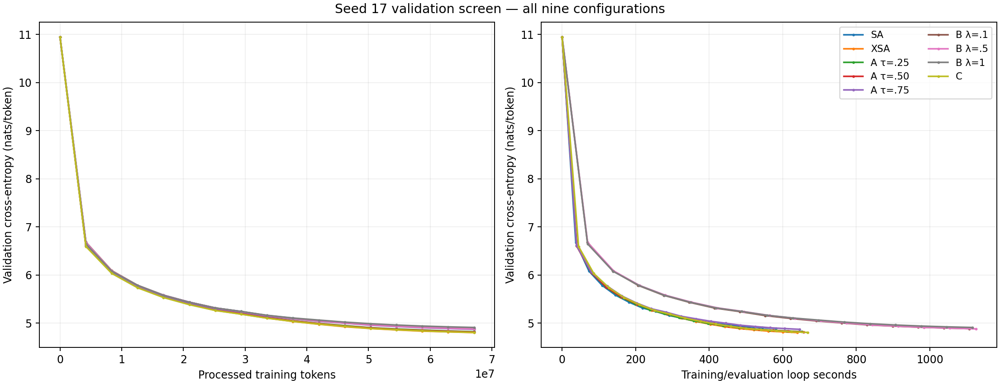
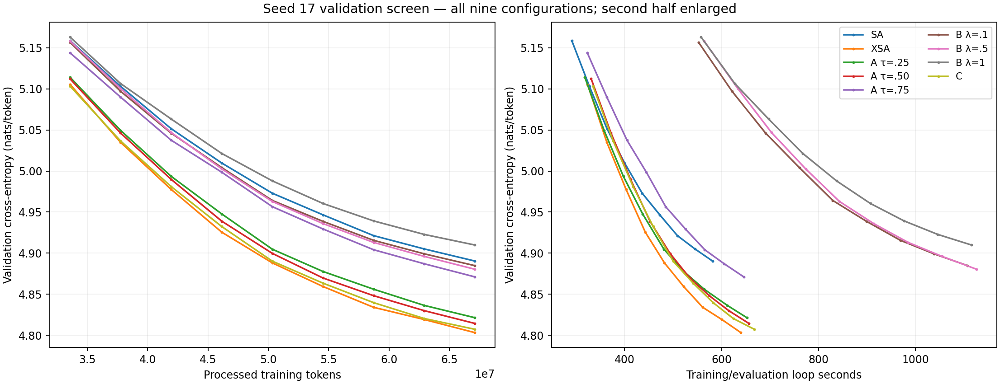

# Midpoint Report: Investigating Alternatives to Exclusive Self Attention

**Status:** implementation and single-seed screening complete; confirmation and mechanism experiments remain.

**Date:** November 24, 2026.

**Evidence baseline:** repository commit [8246376](https://github.com/ptshen/xsa-research/commit/82463765fce45770ae763e87b4e236cf7a6ade7d). This report synthesizes the completed experiments; its proposed follow-ups have not been run.

## Project overview

We are investigating whether attention can use context more effectively by changing how its output aligns with the current token's value vector. We implemented standard self-attention (SA), Exclusive Self Attention (XSA), and three extensions: an adaptive alignment cap (A), a value-similarity penalty on attention logits (B), and projection in the geometry of the output matrix (C). We also built a reproducible training, evaluation and checkpoint/resume pipeline on Columbia's Insomnia cluster.

The completed screen contains **nine configurations**, each trained for **67,108,864 tokens** with the same approximately 30M-parameter architecture, initialization, minibatch order and evaluation windows. XSA has the lowest observed validation cross-entropy. C is the closest extension, but does not establish an improvement over XSA. A improves over SA but trails XSA; B offers smaller gains over SA at its weaker settings, becomes worse than SA at its strongest setting, and has the largest implementation cost.

These findings do not support our initial expectation that the proposed modifications would improve on XSA under this pilot recipe. They do provide a verified baseline and specific questions for the next stage: whether C's small gap is reproducible, whether projection direction or update magnitude explains the gains, and whether aggregate language-model loss hides differences in copying, retrieval or updating information.

## 1. Research questions and implemented methods

The original XSA paper identifies substantial alignment between an attention output and its own position's value vector, and proposes removing that component. It reports language-model loss curves and downstream accuracy comparisons. Our project examines alternatives to this intervention at a much smaller experimental scale. [Zhai, *Exclusive Self Attention*, v1](https://arxiv.org/html/2603.09078v1).

For one attention head, let the ordinary causal attention aggregate be

$$
a_{ij}=\mathrm{softmax}_{j\le i}\!\left(\frac{q_i^\top k_j}{\sqrt{d_h}}\right),
\qquad y_i=\sum_{j\le i}a_{ij}v_j.
$$

Here, $v_i$ is the current token's **head value**, not the token embedding or full residual-stream vector. All methods act before head concatenation and the output projection. They share the same learned parameter names, shapes and counts.

### Baselines: SA and XSA

SA passes $y_i$ to the output projection. XSA removes its component along the current token's value:

$$
z_i^{\mathrm{XSA}}=y_i-\frac{y_i^\top v_i}{\|v_i\|^2}v_i.
$$

For nondegenerate inputs in exact arithmetic, this makes the corrected output orthogonal to $v_i$. It removes aligned contributions regardless of which context position supplied them; it is not equivalent to masking the attention diagonal. Whether those contributions are redundant or useful is an empirical question.

### Direction A: limit excessive alignment

**Hypothesis:** moderate alignment may preserve useful copying or contextual reinforcement that complete removal discards.

We decompose the aggregate into parallel and perpendicular components and clip the parallel coefficient:

$$
u_i=\frac{v_i}{\|v_i\|},\quad c_i=y_i^\top u_i,\quad r_i=y_i-c_i u_i,
\quad b_i=\frac{\tau}{\sqrt{1-\tau^2}}\|r_i\|,
\qquad z_i=r_i+\mathrm{clip}(c_i,-b_i,b_i)u_i.
$$

The bound limits the **absolute** cosine alignment for nonzero, numerically resolved outputs. We screened $\tau\in\{0.25,0.50,0.75\}$. At zero, A recovers XSA. The intervention clips negative as well as positive alignment. It is also not a simple interpolation to SA: for a collinear aggregate, including the first causal position, the perpendicular component is zero and every threshold below one produces zero output in exact arithmetic.

### Direction B: penalize similar values before softmax

**Hypothesis:** selecting less redundant context before aggregation may work better than removing information afterward.

$$
s'_{ij}=\frac{q_i^\top k_j}{\sqrt{d_h}}
-\lambda\max\!\left(0,\cos(v_i,v_j)\right),
\qquad z_i=\sum_{j\le i}\mathrm{softmax}_{j\le i}(s'_{ij})v_j.
$$

We screened $\lambda\in\{0.1,0.5,1.0\}$. The penalty includes the diagonal, the values being aggregated remain unchanged, and gradients flow through value similarity. Lambda zero recovers SA within the tested numerical tolerances. B encourages different attention allocation but does not enforce output orthogonality. Its first position still returns its sole available value.

B uses explicit fp32 attention with 128-query chunks. This supports the value-dependent score modification and preserves causal masking across chunk boundaries. It also changes the attention backend relative to the flash-SDPA baselines, which matters when interpreting its cost.

### Direction C: project using the output geometry

**Hypothesis:** the space in which a head writes its update may be more relevant than its internal value coordinates.

For the actual head-column block $W_{O,h}$ of the output matrix, we compute

$$
G_h=W_{O,h}^\top W_{O,h},
\qquad z_i=y_i-\frac{v_i^\top G_h y_i}{v_i^\top G_h v_i}v_i.
$$

This gives $(W_{O,h}z_i)^\top(W_{O,h}v_i)=0$ for resolved nondegenerate inputs in exact arithmetic. It is a **per-head** property, not a guarantee about the sum of all heads or the residual stream. The metric is recomputed from current weights on every forward pass, with gradients through those weights. There are no new parameters, matrix inverses or detached metrics. Ordinary aggregation retains flash SDPA.

The numerical implementation uses a scale-aware denominator guard, described below. Identity-metric tests recover XSA on nondegenerate inputs; bf16 rounding and guarded cases qualify the exact geometric statement.

## 2. Experimental setup and workflow

### Environment and implementation

We used SSH alias `insomnia`, working under `~/algollms/xsa`, with code and compact evidence published to [ptshen/xsa-research](https://github.com/ptshen/xsa-research). Heavy computation ran on allocated Slurm nodes using the available `edu/short` allocation: one NVIDIA RTX A6000, eight CPUs and 32 GiB RAM for GPU jobs. Experiments ran sequentially. CPU collection used separate allocations. No paid cloud resources were used.

The cluster environment records Python 3.11.5, PyTorch 2.10.0+cu128, CUDA 12.8 and NumPy 2.4.6. The model follows the project's pinned nanoGPT-derived specification, with RoPE, LayerNorm after token embeddings, and independently configurable head count/dimension. Reported, inherited and assumed settings are distinguished in [REPRODUCTION_SPEC.md](REPRODUCTION_SPEC.md); the author's modified training-code commit is not known.

The main implementation is [xsa/model.py](xsa/model.py). Data preparation, initialization, training, evaluation, diagnostics and profiling have separate entry points. Slurm launchers record requested walltime before submission, inspect prior job IDs, and reject duplicate or uncertain submissions. Logs and checkpoints are retained; an SSH timeout does not trigger a replacement job.

### Data preparation

We prepared a bounded prefix of FineWeb `sample-100BT`, pinned to revision `9bb295ddab0e05d785b879661af7260fed5140fc`, using GPT-2 tokenization. Whole document IDs are assigned to training or validation by a deterministic hash with split seed 2026 and validation probability 0.0005. Within each split, source order is preserved and one EOS token is appended per document. This avoids shuffling individual tokens into artificial text. It is a documented approximation to the original paper's split description.

The prepared data contain:

- **Training:** 99,962,616 tokens from 146,329 documents.
- **Validation:** 36,418 tokens from 74 documents.
- **Evaluation:** the same 64 nonoverlapping windows, each with 512 target tokens, totaling 32,768 targets.

Training samples valid starts with replacement; training windows may overlap one another. Training and validation documents are disjoint by ID, but no stronger semantic deduplication guarantee is claimed. The manifests record ordering, tokenization, splitting and checksums. There is no untouched test split yet. See the [data manifest](evidence/pilot/data_manifest.json).

### Matched training configuration

| Setting | Value used in every screened configuration |
|---|---|
| Unique parameters | 29,938,944 total; 10,622,208 excluding the tied token embedding/output head |
| Architecture | 6 layers; model width 384; 6 heads × 64 dimensions; context 512 |
| Vocabulary / dropout | 50,304 / 0 |
| Model / data / evaluation seeds | 17 / 1017 / 2017 |
| Initialization | Shared saved state, `runs/initial/pilot-s17.pt` |
| Optimizer | AdamW; betas (0.9, 0.95); weight decay 0.1; gradient clipping 1.0 |
| Learning rate | Peak 0.0006; 64 warmup updates; cosine decay to 0.00006 |
| Batch | 8 sequences × 8 accumulation steps × 512 tokens = 32,768 tokens/update |
| Training budget | 2,048 updates = 67,108,864 processed tokens/run |
| Precision | bf16 training; fp32 attention-correction reductions; fp32 parameters/optimizer state |
| Evaluation / checkpoint schedule | Every 128 / 64 updates |

Across nine runs, we processed **603,979,776 training tokens**. This is the sum across models, not the amount of unique data. Every ordered minibatch hash was checked against the baseline; evaluation uses a separate random-number stream and does not change future training batches.

### Execution sequence

| Stage | Work completed | Recorded GPU allocation |
|---|---|---:|
| Foundation | Implement SA/XSA, pin specification, test numerical behavior/resume, run fixture smoke and pilot-shape profiles | 49 s smoke/profile |
| Baseline pilot | Prepare real data and shared initialization; train SA and XSA; collect matched results | 1,287 s |
| Direction A | Verify unchanged baselines; profile and train all three caps; collect five-method comparison | 2,049 s, including verification |
| Directions B/C | Implement and verify B/C; re-evaluate preserved baselines; profile nine methods; train four new configurations | 4,310 s, including verification |
| Final collection | Load/check nine checkpoint pairs, reconstruct histories, recompute comparisons and plots, audit resources | CPU-only; final B/C collector 75 s |

These recorded GPU allocations sum to **7,695 seconds, or 2.14 A6000 GPU-hours**, excluding CPU preparation/collection and queue time. The separate stage budgets were respected. B/C verification/profiling used 163 seconds of its 600-second allowance. Final project storage was approximately **10.28 GiB**; the conservative temporary-save peak estimate was 11.40 GiB, below the 12 GiB stage cap. Peak disk use was estimated rather than continuously sampled.

The completed training IDs are SA `14072327`, XSA `14072338`, A `14072518/14074753/14074780`, B `14076378/14076783/14076831`, and C `14076871`. B/C verification used `14076373/14076777`; final collection used `14076904`. Exact submission commands and resource records remain in the [stage report](DIRECTIONS_BC_REPORT.md#actual-commands-and-recovery) and [PROGRESS.md](PROGRESS.md). Completed runs were reused rather than retrained for each comparison.

### Correctness, recovery and reproducibility

We used red/green tests for independent attention references, output and gradient comparisons, float64 gradient checks, causality, head layout, zero/near-zero and rank-deficient cases, parameter identity, exact token accounting and checkpoint/resume behavior. Latest and previous checkpoints are written atomically and retain model, optimizer, schedule, RNG and data state. Resume rejects changed method/configuration/data settings. Deterministic interrupted/uninterrupted tests pass; the full screening runs did not need interruption or continuation.

The final allocated CUDA suite passed **92 tests with zero failures or skips**. Locally, **79 passed and 13 CUDA-only tests were skipped**, which is distinct from GPU execution. A separate ten-test accounting suite passed. Re-evaluating all five preserved SA/XSA/A checkpoints gave maximum per-window loss difference **0.0**. The independent CPU audit loaded all **18 latest/previous checkpoints**, checked finite model/optimizer tensors and complete histories, and reproduced losses, perplexities and comparison intervals. [Verification proof](evidence/direction_bc/verification.json), [checkpoint audit](evidence/direction_bc/independent_checkpoint_audit.json).

Verification also found a substantive defect. C's original absolute-only denominator guard could amplify a near-null, rank-one case: aggregate norm 0.7993 became corrected norm 313.35 through Gram-matrix roundoff. We preserved the failing test and replaced the guard with an absolute plus dtype/dimension/value/weight-scaled threshold. Guarded branches use a safe denominator before division and skip correction. A second GPU gate passed **before any C training**. This fix adds neither ridge regularization nor an inverse, but explicitly limits the orthogonality claim near degeneracy. [Failure and repair evidence](evidence/direction_bc/geometry_guard_red.txt), [numerical protocol](DIRECTIONS_BC_PROTOCOL.md).

## 3. Results

### Language-model performance

Our primary outcome is token-weighted held-out next-token cross-entropy (CE), in nats/token, at the fixed training budget. Perplexity is $\exp(\mathrm{CE})$ and therefore gives the same ordering; it is not a second benchmark. This connects to the paper's loss-curve evaluation, while its downstream accuracy results represent a separate evaluation we have not executed. [Original experimental results](https://arxiv.org/html/2603.09078v1#S4.SS2).

| Method | Cross-entropy ↓ | Perplexity ↓ | CE minus SA | CE minus XSA |
|---|---:|---:|---:|---:|
| SA | 4.89046994 | 133.01607 | +0.00000000 | +0.08713721 |
| XSA | **4.80333272** | **121.91605** | -0.08713721 | +0.00000000 |
| A, τ=0.25 | 4.82149275 | 124.15028 | -0.06897719 | +0.01816002 |
| A, τ=0.50 | 4.81451356 | 123.28683 | -0.07595638 | +0.01118083 |
| A, τ=0.75 | 4.87118640 | 130.47562 | -0.01928354 | +0.06785367 |
| B, λ=0.1 | 4.88484551 | 132.27003 | -0.00562443 | +0.08151279 |
| B, λ=0.5 | 4.88045164 | 131.69013 | -0.01001830 | +0.07711892 |
| B, λ=1.0 | 4.90996214 | 135.63428 | +0.01949220 | +0.10662942 |
| C | 4.80739097 | 122.41182 | -0.08307897 | +0.00405825 |

Selected paired differences illustrate the uncertainty:

| Comparison | CE difference | Paired-window bootstrap 95% interval |
|---|---:|---:|
| XSA minus SA | -0.08713721 | [-0.09983558, -0.07541422] |
| Best A (τ=0.50) minus XSA | +0.01118083 | [+0.00370309, +0.01938553] |
| Best B (λ=0.5) minus XSA | +0.07711892 | [+0.06636608, +0.08942982] |
| C minus XSA | +0.00405825 | [-0.00311979, +0.01139933] |

Intervals use 2,000 paired resamples of the 64 validation windows, with bootstrap seed 2026. They assume independent windows; shared-document correlations may make them optimistic. **They do not measure training-seed variability or account for selecting configurations on this validation set.** C's interval crossing zero does not establish equivalence to XSA. B λ=0.1 also has a window interval crossing zero against SA. All comparisons, including negative outcomes, remain in [summary.json](evidence/direction_bc/results/summary.json).

The enlarged curves show that C tracks XSA closely, while B's additional cost becomes clear when the horizontal axis is elapsed time. These plots cover the completed budget; they do not show that any method has converged or predict a later crossover.

### Computational cost

The following profile measures complete accumulation-8 updates at the actual pilot shape, on one A6000 with warmup and synchronization. It excludes data I/O, evaluation, diagnostics and checkpoint writes.

| Method | Update time (ms) | Overhead versus XSA | Profile peak allocation (GiB) |
|---|---:|---:|---:|
| SA | 245.166 | -11.38% | 3.872 |
| XSA | 276.660 | 0.00% | 4.205 |
| A, τ=0.25 | 290.919 | +5.15% | 4.246 |
| A, τ=0.50 | 291.168 | +5.24% | 4.244 |
| A, τ=0.75 | 291.305 | +5.29% | 4.246 |
| B, λ=0.1 | 518.353 | +87.36% | 4.987 |
| B, λ=0.5 | 518.437 | +87.39% | 4.982 |
| B, λ=1.0 | 517.717 | +87.13% | 4.980 |
| C | 286.987 | +3.73% | 4.247 |

B's cost includes explicit fp32 softmax/matrix multiplication replacing flash SDPA, so it is not an isolated measurement of the penalty itself. Query chunking does not establish a reduction in total backward memory. C retains flash SDPA plus Gram-matrix computation. The profiles are short measurements, not repeated performance trials. [Profile evidence](evidence/direction_bc/profile_table.md).

Full allocations, including startup/evaluation/diagnostics, were 624 seconds for SA, 663 for XSA, 658–690 for A, 1,118–1,153 for B, and 726 for C. Full-run timings also include different node/date and I/O conditions. Training-loop throughput was approximately 115k tokens/s for SA, 105k for XSA, 102–104k for A, 60k for B and 100k for C. Full-training peaks were about 3.75 GiB for A/C and 4.49 GiB for B; historical SA/XSA training peaks were not recorded. These differ from profile-process peaks. [Timing records](evidence/direction_bc/results/timing.json).

## 4. Analysis: what the results do and do not tell us

### XSA is the strongest current baseline

XSA improves observed loss over SA by 0.08714 nats/token under exactly matched initialization and training data. This makes XSA the relevant comparison for the extensions: beating SA alone would not establish a contribution beyond the existing correction. The single-seed result supports continuing to use XSA as a baseline, but does not establish its advantage across seeds, model sizes, datasets or tasks.

### A: preserving moderate alignment did not improve this screen

All three caps beat SA, but every cap trails XSA. The best threshold is 0.50, so performance is not monotonic in the amount of permitted alignment. On the bounded diagnostic sample, the caps activated at approximately **96.3%, 90.6% and 81.6%** of positions, respectively, averaging across layers and heads. Even the loosest tested cap was often active; A did not operate only as an occasional correction of extreme cases.

Possible explanations include a benefit from stronger removal in this training regime, a poor match between one global threshold and heterogeneous heads, or effects of update magnitude rather than alignment alone. These are hypotheses, not findings. We have not compared A with an equally tuned fixed-strength partial-removal baseline, so we cannot attribute its behavior specifically to adaptive clipping. Its symmetric treatment of negative and positive alignment also deserves a targeted control.

### B: the intended geometric change occurred without a competitive loss result

For B λ=1.0, mean attention-weighted positive value similarity fell from **0.26545 to 0.19565**, and diagonal attention mass fell from **0.15609 to 0.09461** when applying the penalty with that model's current weights. Output/self-value alignment fell from **0.37308 to 0.23952**. Nevertheless, this configuration was worse than SA and XSA. Thus, reducing these diagnostic quantities is not sufficient evidence of better prediction.

One explanation to test is that positive value similarity sometimes signals useful copying or reinforcement. Another is that a single lambda has different effective strength across layers with different logit distributions. Since values receive gradients through the penalty, training can also change the representation on which the penalty is computed. None of these mechanisms has been isolated. An explicit-attention SA control would further distinguish method changes from backend/numerical differences; its absence limits a strictly operator-only interpretation.

Given both the loss results and approximately 87% profile overhead versus XSA, optimizing B's implementation is not the highest-priority next step. A small mechanistic ablation is more informative than a larger blind lambda search.

### C: a promising comparison, without an established advantage

C is closest to XSA in loss and adds only 3.73% update time in the matched profile. Its diagnostic written-space alignment changed from **0.79400 to approximately -0.000092**, while head-space alignment after correction remained **-0.21810**. This demonstrates that the two projection spaces can produce different geometry; head-space orthogonality is not required by C's construction.

There were no guard activations on the sampled fp32 diagnostic forwards. This does not imply that guards never activated during bf16 training. Approximately 0.70% of head outputs and 0.78% of written outputs were near zero under the 1e-6 diagnostic cutoff and were treated separately from cosine means. A small signed mean alone does not prove per-vector orthogonality; that property is covered by the independent numerical tests.

The present result does not show that output geometry improves language modeling. C may be close to XSA because both remove a broadly similar component, or because their differences matter more on tasks not captured by this validation set. Comparing correction directions and output-metric spectra on saved checkpoints could help distinguish these possibilities before adding new parameters or increasing training scale.

### Diagnostic scope

These observations use **four fixed 128-token training windows**, seed 7017, with a separate fp32 forward pass. Summaries average per-head results across six layers and six heads. Cosines exclude norms at or below 1e-6; zero/near-zero counts include all positions. Before/after quantities use the same trained weights within each model, but comparisons between trained models also reflect different learned representations. The small sample and signed means can hide substantial heterogeneity. Full distributions, layer/head variation and position effects are appropriate next diagnostic measurements.

## 5. Limitations of the current evidence

1. **One training seed and validation-based selection.** We do not know whether the ranking persists under independent initializations/data orders. There is no untouched test result, and uncertainty intervals do not include model-selection effects.
2. **A small, bounded training/evaluation regime.** The models have 29.94M parameters, context 512 and a 67.1M-token budget. The fixed validation set has only 32,768 targets. These experiments are a pilot, not a reproduction of the paper's large-model training study.
3. **One assumed optimization recipe.** The fixed learning rate provides a matched comparison, but we have not established each method's best recipe or performed the paper's baseline learning-rate selection procedure. [Original setup](https://arxiv.org/html/2603.09078v1#S4.SS1).
4. **Mechanisms remain confounded.** Projection changes both direction and magnitude. A changes signed alignment; B changes attention weights, gradient paths and implementation backend; C changes the metric. No targeted controls isolate these factors yet.
5. **Language-model loss does not directly test contextual reasoning.** Retrieval, copying, updating information and grammatical preference can behave differently. Downstream harness support exists, but full downstream tasks and the proposal's controlled context tasks remain unrun.
6. **Limited efficiency and deployment evidence.** Profiles cover one model/context and short measurement windows. We have not tested long-context scaling, compiled variants or KV-cached decoding; KV caching and distributed training are unsupported in the current trainer.

## 6. Proposed next steps and revised research directions

The next stage should increase the strength and interpretability of the evidence. We should retain the original screen and its negative outcomes, freeze each follow-up protocol before execution, and keep tuning budgets comparable. The suggestions below are proposals, not completed implementations or claims of novelty.

### Priority 1: confirm the closest comparison

Run **SA, XSA and frozen C on three fresh paired seeds**, for example 29, 43 and 59. Pair initialization and batch order within each seed; use independent training randomness across seeds and common evaluation examples. Keep seed 17 as screening evidence. Report each paired difference, its mean and seed-to-seed spread; three seeds remain a small sample.

Prepare separate development and untouched test data at the document level, preserving source pins and disjointness. Freeze method choices and an evaluation plan before inspecting the new test results. Where windows share documents—or cross packed-document boundaries—use a suitable grouped evaluation design rather than treating all windows as independent. Define a practically meaningful loss difference in advance; absence of a clear difference is not proof of equivalence.

Measured complete allocations project to `3 × (624 + 663 + 726) = 6,039 seconds`, or **1.68 A6000 GPU-hours** for nine training runs at the current budget. A conservative reservation proposal is nine 30-minute caps plus five minutes for verification: **4h35m GPU time**, plus a five-minute CPU collection cap. Retaining all old/new checkpoint pairs, three new initial states and temporary-save headroom projects to **17.10 GiB**, requiring a separate storage allowance such as 18 GiB and a fresh quota check. Queue time, new evaluation-data preparation/storage and additional controls are excluded from these estimates. No part of this follow-up has been launched.

### Priority 2: isolate direction, magnitude and selection

We should choose a small control family based on the question, rather than launch all variants together.

| Question | Proposed experiment | Evidence that would change our interpretation |
|---|---|---|
| Does A help because its strength adapts, or merely because it partially removes a component? | Compare A with fixed-strength removal $z=y-\beta(y^\top u)u$, with equal tuning allowance; β=0 is SA and β=1 is XSA. | If fixed strength matches A, adaptive clipping is not needed to explain its benefit over SA. This control was already proposed in the handoff; no novelty claim is made. |
| Does XSA help through direction or through a smaller attention update? | Compare full projection with norm-restored projection and a control that only shrinks the ordinary aggregate; cap unstable rescaling and report guard frequency. | If matched shrinking reproduces the benefit, a direction-specific redundancy explanation weakens. If norm restoration removes the gain, scale is a candidate mechanism. |
| Is B responding mainly to self attention or to similar context values? | Compare diagonal-only and off-diagonal-only penalties at frozen strengths, plus an explicit-attention SA control. A separately labeled stop-gradient penalty could isolate its representation-gradient effect. | These separate suppression of the self position, contextual similarity and the extra value-gradient path; none is established by the current diagonal-mass change alone. |

### Candidate extensions after the controls

Two focused modifications could follow if diagnostics justify them:

- **Interpolate projection geometry.** For nondegenerate output weights, use $G_{\alpha,h}=(1-\alpha)\bar g_h I+\alpha G_h$, where $\bar g_h=\mathrm{tr}(G_h)/d_h$. In exact arithmetic, the endpoints recover Euclidean/XSA and output-geometry/C projection. A small frozen grid can ask whether an intermediate geometry is useful. Shared numerical guards and endpoint tests are necessary; this is an unimplemented hypothesis, not a demonstrated improvement.
- **Distinguish positive and negative alignment.** A currently clips both signs, although the motivating bias is positive alignment. A positive-only cap would preserve negative parallel components and test whether symmetric clipping discards useful countervailing information. Measure signed activation and loss by position/head first. At threshold zero this variant would not generally equal XSA, which removes either sign.

Learned per-head strengths or thresholds are another possible extension, but introduce parameters and more tuning freedom. They should follow fixed-strength and headwise diagnostic controls, with matched-capacity comparisons and a related-work review before any novelty claim.

### Priority 3: test the behavioral hypotheses directly

The original proposal includes controlled tasks that are more diagnostic of context use than aggregate web-text loss:

| Task | Controlled change | Outcome |
|---|---|---|
| Associative retrieval | Independently vary distractor count and distance to a key–value pair | Answer-token accuracy |
| Copying/repetition | Vary useful repeated spans separately from irrelevant repetition | Exact span match and token accuracy |
| Updating information | Repeat a key with a new value and query the current assignment | Latest-value accuracy versus obsolete-value errors |

Train small matched models on the same procedural task mixture, with disjoint train/test sequences and assignments. Do not infer a tiny web-trained model's architectural ability from whether it follows a new instruction prompt. Measure actual internal value similarities: repeated token identities do not guarantee similar hidden values. Separate within-training-context tests from longer-context extrapolation, and use paired examples and multiple seeds.

As a secondary language check, BLiMP evaluates whether a model prefers the grammatical member of a minimal sentence pair. It could test preservation of grammatical preferences, but would not establish contextual reasoning. It has not been run here. [Warstadt et al., *BLiMP*](https://aclanthology.org/2020.tacl-1.25/).

Only after a reproducible benefit or a clear mechanism emerges should we expand model size/context, optimize B's kernels, or combine interventions. If C remains indistinguishable in practical quality while costing more, XSA remains the simpler baseline. A careful account of where the extensions fail—and what controls explain that failure—is a valid project outcome.

## 7. Midpoint deliverables and remaining work

The engineering foundation is complete: tested SA/XSA/A/B/C implementations, reproducible configs/data preparation, bounded Slurm submission, atomic checkpoint/resume, matched evaluation, diagnostics, profiling, plots, manifests and independent audits. All nine screening runs are complete, logs/checkpoints are preserved on Insomnia, and source plus compact results are published to GitHub.

The scientific work remaining is confirmation and explanation. No extension has yet established an advantage over XSA. Our proposed continuation prioritizes fresh-seed evidence, an untouched evaluation protocol, and controls that can distinguish useful alignment from effects of update scale or attention selection. Broader context-use and novelty claims remain contingent on those experiments.

### Evidence guide

| Artifact | Purpose |
|---|---|
| [REPRODUCTION_SPEC.md](REPRODUCTION_SPEC.md) | Source pins, assumptions and deviations from the paper |
| [PILOT_REPORT.md](PILOT_REPORT.md) | Original matched SA/XSA pilot |
| [DIRECTION_A_REPORT.md](DIRECTION_A_REPORT.md) | Alignment-cap screen and diagnostics |
| [DIRECTIONS_BC_REPORT.md](DIRECTIONS_BC_REPORT.md) | Full nine-configuration results, costs, commands and numerical conventions |
| [DIRECTIONS_BC_MANIFEST.json](DIRECTIONS_BC_MANIFEST.json) | Machine-readable final identities, results and audits |
| [Completion audit](DIRECTIONS_BC_COMPLETION_AUDIT.md) | Requirement-by-requirement evidence for the completed screen |
| [PROGRESS.md](PROGRESS.md) | Chronological decisions, failures, job IDs and next actions |

Earlier stage reports describe the state at their respective completion dates; the combined B/C report and this midpoint report reflect the completed nine-configuration screen.
